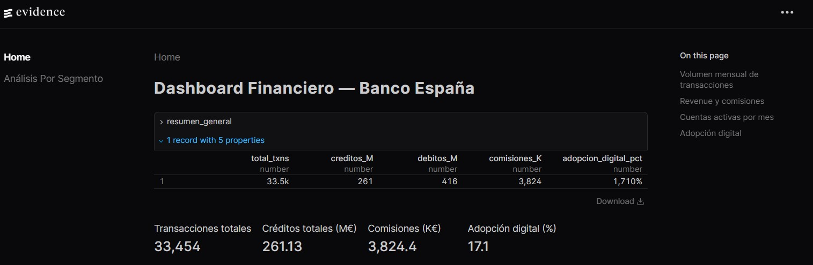
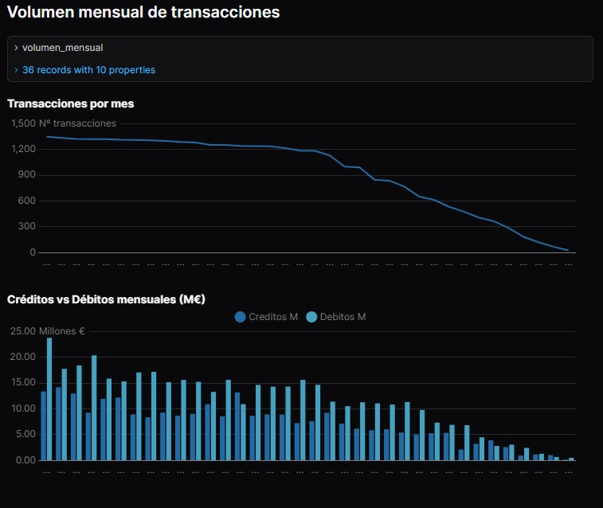
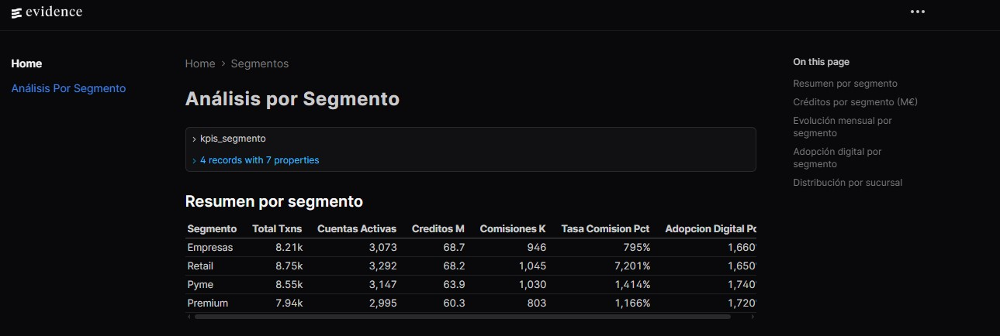
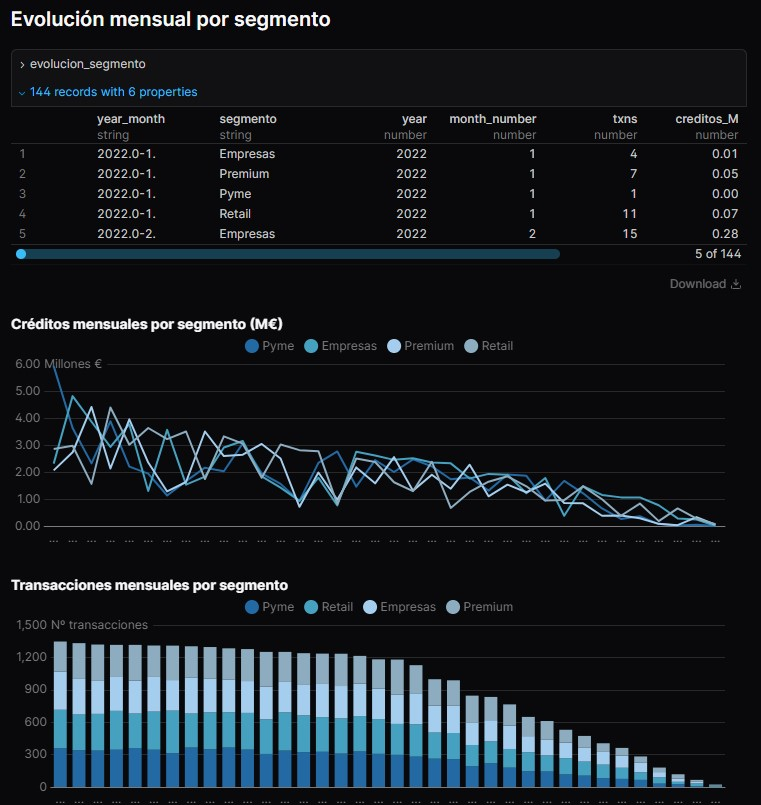
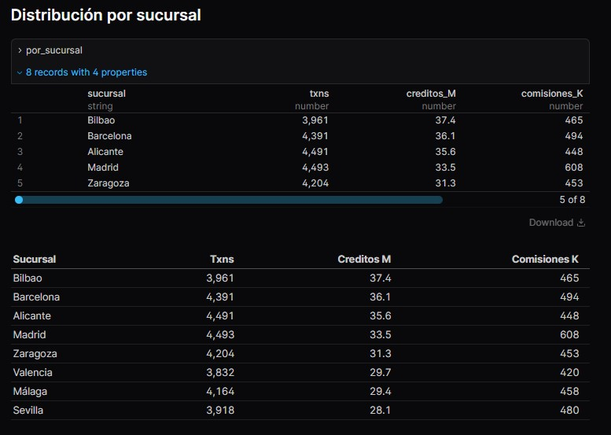

# 203.1 · Financial Data Warehouse — Star Schema ETL

> End-to-end open-source Data Warehouse for financial transaction analytics.
> Medallion architecture (Bronze → Silver → Gold), SCD Type 2 dimensions,
> 50k synthetic transactions and a live Evidence.dev dashboard.

---

## 📸 Dashboard Preview

> *Home Page*






> *Segment Analysis*






---

## 🏗️ Architecture

```
┌─────────────────────────────────────────────────────────────┐
│  SOURCE                                                      │
│  Python · Faker  →  accounts.csv  transactions.csv  ...     │
└──────────────────────────┬──────────────────────────────────┘
                           │
                           ▼
┌─────────────────────────────────────────────────────────────┐
│  🥉 BRONZE  (Views — raw typing only)                       │
│  stg_transactions  stg_accounts  stg_products               │
│  stg_account_changes                                        │
└──────────────────────────┬──────────────────────────────────┘
                           │  dbt models
                           ▼
┌─────────────────────────────────────────────────────────────┐
│  🥈 SILVER  (Tables — cleaned, conformed, historicised)     │
│  dim_account  ← SCD Type 2  (segment, risk_level)          │
│  dim_product  ← SCD Type 2  (interest rates, fees)         │
│  dim_date     ← calendar 2022–2025 (ES locale + fiscal)    │
└──────────────────────────┬──────────────────────────────────┘
                           │  dbt models
                           ▼
┌─────────────────────────────────────────────────────────────┐
│  🥇 GOLD  (Tables — business aggregates)                    │
│  fact_transactions  ← SCD2-aware joins                      │
│  mart_kpis          ← monthly KPIs by segment & branch     │
│  vw_dashboard       ← flat view for Evidence.dev           │
└──────────────────────────┬──────────────────────────────────┘
                           │
                           ▼
                  Evidence.dev Dashboard
```

---

## ⚙️ Tech Stack

| Tool | Role | Cloud equivalent |
|---|---|---|
| **Python + Faker** | Synthetic data generation | SSIS / ADF |
| **DuckDB** | Analytical SQL engine (file-based) | Azure Synapse / Fabric |
| **dbt Core** | Layered transformations + lineage + tests | Fabric Dataflows / dbt Cloud |
| **Evidence.dev** | SQL-driven dashboard | Power BI |

> Everything runs **locally at zero cost** — no cloud account needed.

---

## 📊 Domain — Fictitious Bank (Spain)

| Entity | Rows | Description |
|---|---|---|
| Accounts | 500 | Customers across 4 segments (Retail, Premium, Empresas, Pyme) and 8 Spanish branches |
| Products | 12 | Savings accounts, credit cards, loans, investment funds |
| Transactions | 50,000 | Transfers, payments, ATM withdrawals, nóminas |
| Account changes | ~167 | Attribute changes driving SCD Type 2 history |

---

## 🔑 Key Concepts Demonstrated

### SCD Type 2 — Point-in-time accuracy

Each transaction is joined to the **dimension version active on the transaction date** — not the current one. This is the correct approach for financial reporting.

```sql
-- dim_account: each row = one VERSION of an account
SELECT account_id, segment, risk_level, valid_from, valid_to, is_current
FROM silver.dim_account
WHERE account_id = 'ACC-00042'
ORDER BY valid_from;

-- account_id   segment   risk_level  valid_from   valid_to     is_current
-- ACC-00042    Retail    Bajo        2022-03-15   2023-08-10   false
-- ACC-00042    Premium   Medio       2023-08-11   NULL         true

-- SCD2-aware join in fact_transactions
SELECT t.transaction_id, t.transaction_date, a.segment, a.risk_level
FROM gold.fact_transactions t
JOIN silver.dim_account a
  ON  t.account_id        = a.account_id
  AND t.transaction_date >= a.valid_from
  AND (t.transaction_date <= a.valid_to OR a.valid_to IS NULL);
```

### Star Schema

```
         dim_date ──────────────────┐
                                    │
dim_account ──── fact_transactions ─┤
                                    │
dim_product ──────────────────────┘
```

### Medallion Architecture

| Layer | Materialization | Purpose |
|---|---|---|
| Bronze | Views | Raw ingestion, typing only |
| Silver | Tables | Cleaned, SCD2, conformed |
| Gold | Tables | Business KPIs, mart aggregates |

---

## 📁 Project Structure

```
203.1-Data-Warehouse-Star-Schema-ETL/
│
├── data/
│   ├── generate_data.py        ← synthetic data generator
│   ├── raw/                    ← generated CSVs       [gitignored]
│   └── finanzas_dw.db          ← DuckDB database      [gitignored]
│
├── dbt_project/
│   ├── dbt_project.yml
│   ├── profiles.yml
│   └── models/
│       ├── schema.yml          ← tests + documentation
│       ├── 100-bronze/
│       │   ├── stg_transactions.sql
│       │   ├── stg_accounts.sql
│       │   ├── stg_products.sql
│       │   └── stg_account_changes.sql
│       ├── 200-silver/
│       │   ├── dim_account.sql      ← SCD Type 2
│       │   ├── dim_product.sql      ← SCD Type 2
│       │   └── dim_date.sql
│       └── 300-gold/
│           ├── fact_transactions.sql
│           ├── mart_kpis.sql
│           └── vw_dashboard.sql
│
└── dashboard/                  ← Evidence.dev
    ├── sources/finanzas/
    │   ├── connection.yaml
    │   ├── vw_dashboard.sql
    │   ├── mart_kpis.sql
    │   └── fact_transactions.sql
    └── pages/
        ├── index.md            ← volume & revenue
        └── segmentos.md        ← segment analysis
```

---

## 🚀 Quick Start

### 1 — Clone and create virtual environment

```bash
git clone https://github.com/ecartolariesteves/200-Data-Engineering-Projects.git
cd 200-Data-Engineering-Projects/203-data-modeling/203.1-Data-Warehouse-Star-Schema-ETL

python -m venv .venv

# Windows (PowerShell)
.venv\Scripts\Activate.ps1

# macOS / Linux
source .venv/bin/activate
```

### 2 — Install Python dependencies

```bash
pip install faker duckdb dbt-duckdb
```

### 3 — Generate synthetic data

```bash
# Run from project root
python data/generate_data.py
```

### 4 — Run the dbt pipeline

```bash
# ⚠️  Run from project root, not from inside dbt_project/
dbt run  --project-dir dbt_project --profiles-dir dbt_project
dbt test --project-dir dbt_project --profiles-dir dbt_project
```

Expected:
```
Done. PASS=10 WARN=0 ERROR=0    (dbt run)
Done. PASS=30 WARN=0 ERROR=0    (dbt test)
```

### 5 — Launch the dashboard

```bash
cd dashboard
npm install
npm run sources
npm run dev
# → http://localhost:3000
```

> **Note:** Close DBeaver before running `dbt run` — DuckDB does not allow
> concurrent write connections.

---

## ✅ dbt Test Results

| Layer | Model | Tests | Status |
|---|---|---|---|
| Bronze | stg_transactions | unique, not_null, accepted_values | ✅ PASS |
| Bronze | stg_accounts | unique, not_null, accepted_values | ✅ PASS |
| Bronze | stg_products | unique, not_null | ✅ PASS |
| Bronze | stg_account_changes | unique, not_null | ✅ PASS |
| Silver | dim_account | unique, not_null | ✅ PASS |
| Silver | dim_product | unique, not_null | ✅ PASS |
| Silver | dim_date | unique, not_null | ✅ PASS |
| Gold | fact_transactions | unique, not_null | ✅ PASS |

---


## 🗄️ Data Model — Star Schema ERD

> Full diagram: [docs/erd.md](docs/erd.md)

```
                    ┌─────────────┐
                    │  dim_date   │
                    │  (date_key) │
                    └──────┬──────┘
                           │
┌──────────────┐    ┌──────┴──────────────┐    ┌───────────────┐
│ dim_account  │    │  fact_transactions  │    │  dim_product  │
│ (SCD Type 2) ├────┤  transaction_key PK ├────┤  (SCD Type 2) │
│ account_key  │    │  account_key FK     │    │  product_key  │
│ valid_from   │    │  product_key FK     │    │  valid_from   │
│ valid_to     │    │  date_key FK        │    │  valid_to     │
│ is_current   │    │  amount             │    │  is_current   │
└──────────────┘    │  fee_amount         │    └───────────────┘
                    │  credit_amount      │
                    │  debit_amount       │
                    └──────┬──────────────┘
                           │ aggregated
                    ┌──────┴──────┐
                    │  mart_kpis  │
                    └──────┬──────┘
                           │ aggregated
                    ┌──────┴──────────┐
                    │  vw_dashboard   │
                    │  (Evidence.dev) │
                    └─────────────────┘
```

The SCD2 join pattern — used in `fact_transactions`:
```sql
JOIN dim_account a
  ON  t.account_id        = a.account_id
  AND t.transaction_date >= a.valid_from
  AND (t.transaction_date <= a.valid_to OR a.valid_to IS NULL)
```

---

## 🏛️ Layer convention — why Medallion?

This project follows the **Medallion (modern) convention** rather than the classic Kimball layout:

| Convention | Staging | Dimensions | Facts + Marts |
|---|---|---|---|
| **Kimball classic** (Fabric, Synapse) | Staging layer | DW layer (dims + facts together) | Data marts |
| **Medallion modern** (dbt, Databricks) | Bronze | Silver (dims) | Gold (facts + marts) |

**Why put dims in Silver instead of Gold?**

In Medallion, Silver contains *conformed, reusable entities* — `dim_account` can serve `fact_transactions` today but also a future `fact_loans` or `fact_deposits` without being coupled to any one Gold domain. If dims lived in Gold they would be owned by a specific business area.

In practice, both conventions are valid. The choice here reflects the open-source stack (dbt + DuckDB) where Medallion is the dominant pattern.

---
## 💡 Design Decisions

**DuckDB over PostgreSQL** — in-process OLAP engine, no server setup, reads CSV/Parquet natively. Open-source equivalent of Fabric's SQL Analytics Endpoint.

**dbt Core over raw SQL scripts** — enforces Bronze/Silver/Gold separation, generates lineage docs, runs data quality tests out of the box.

**SCD Type 2 over Type 1** — financial transactions must be attributed to the segment/risk profile active *at the time of the transaction*, not the current one. SCD Type 2 with `valid_from`/`valid_to` range joins is the correct pattern.

**Evidence.dev over Power BI** — dashboard-as-code, version-controlled, zero licensing cost, deploys as a static site.


---

*Part of the [200 Data Engineering Projects](https://github.com/ecartolariesteves/200-Data-Engineering-Projects) series.*
