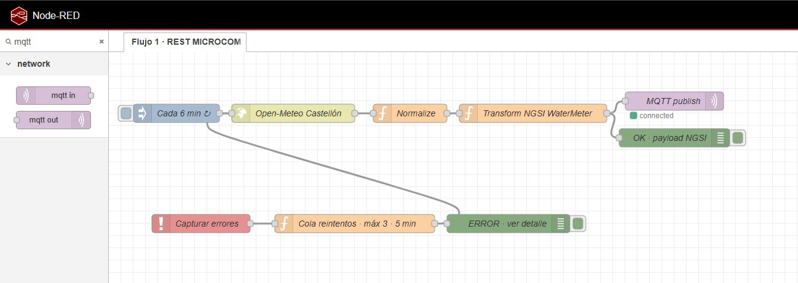
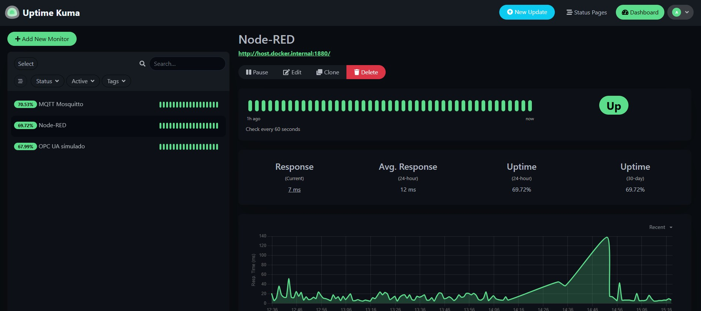
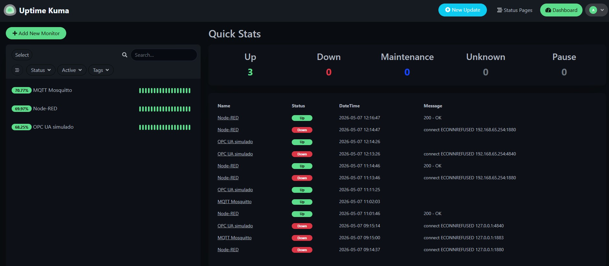

# POC · Node-RED IoT Pipeline · Fase 1

Entorno de práctica local que replica la arquitectura del proyecto de contadores de agua de la Diputación de Castellón.

---

## Arquitectura

```
┌─────────────────────────────────────────────────────────┐
│                     NODE-RED :1880                      │
│                                                         │
│  [Inject 6min] → [Open-Meteo] → [Normalize]            │
│                                     ↓                   │
│                               [Transform]               │
│                            NGSI WaterMeter              │
│                                     ↓                   │
│  [Inject 3min] → [OPC UA] → [Normalize] → [MQTT out]   │
│                                                         │
│  [Catch] → [Cola reintentos máx 3 · 5min]              │
└─────────────────────────────────────────────────────────┘
         ↓ MQTT topics:
┌─────────────────┐      ┌──────────────────────┐
│ Mosquitto :1883 │      │  OPC UA sim  :4840   │
│   (Docker)      │      │  (Node.js local)     │
└─────────────────┘      └──────────────────────┘
         ↓
┌─────────────────┐
│ Uptime Kuma     │
│    :3001        │
└─────────────────┘
```


## Requisitos previos

| Herramienta | Versión mínima | Instalación |
|---|---|---|
| Node.js | 20.x LTS | [nodejs.org](https://nodejs.org) |
| Docker Desktop | cualquiera | [docker.com](https://www.docker.com/products/docker-desktop) |
| Git | cualquiera | [git-scm.com](https://git-scm.com) |

---

## Estructura del repositorio

```
📁 proyecto/
├── 📁 simulated-environment/
│   └── 📁 opcua-sim/
│       ├── server.js          ← servidor OPC UA simulado
│       └── package.json
├── 📁 mosquitto/
│   └── mosquitto.conf         ← configuración del broker MQTT
├── 📁 nodered/
│   └── flows.json             ← flujos Node-RED exportados
├── 📁 img/
│   └── img_x.jpg              ← img para README
├── start.ps1                  ← script de arranque Windows
├── stop.ps1                   ← script de parada Windows
└── README.md
```

---
## NODE.RED



---

## Uptime Kuma





---


## Instalación paso a paso

### 1. Clonar el repositorio

```powershell
git clone <url-del-repo>
cd <nombre-del-repo>
```

### 2. Instalar Node-RED globalmente

```powershell
npm install -g --unsafe-perm node-red
```

### 3. Instalar nodos extra de Node-RED

```powershell
cd ~\.node-red
npm install @node-red/nodes
npm install node-red-dashboard
npm install node-red-contrib-opcua
```

### 4. Copiar el flujo a Node-RED

```powershell
copy nodered\flows.json ~\.node-red\flows.json
```

> ⚠️ Si ya tienes flujos en Node-RED, haz backup primero:
> `copy ~\.node-red\flows.json ~\.node-red\flows.backup.json`

### 5. Instalar dependencias del servidor OPC UA

```powershell
cd simulated-environment\opcua-sim
npm install
cd ..\..
```

### 6. Arrancar Docker Desktop

Abre Docker Desktop desde el menú inicio y espera a que el icono de la ballena deje de moverse.

---

## Arranque del entorno

### Opción A — Script automático (recomendado)

```powershell
.\start.ps1
```

### Opción B — Manual (una terminal por servicio)

**Terminal 1 — Mosquitto:**
```powershell
docker start mosquitto
# Si es la primera vez:
docker run -d --name mosquitto -p 1883:1883 -v ".\mosquitto\mosquitto.conf:/mosquitto/config/mosquitto.conf" eclipse-mosquitto
```

**Terminal 2 — Uptime Kuma:**
```powershell
docker start uptime-kuma
# Si es la primera vez:
docker run -d --name uptime-kuma -p 3001:3001 -v uptime-kuma:/app/data louislam/uptime-kuma:1
```

**Terminal 3 — Servidor OPC UA:**
```powershell
cd simulated-environment\opcua-sim
node server.js
```

**Terminal 4 — Node-RED:**
```powershell
node-red
```

---

## Verificación

| Servicio | URL | Estado esperado |
|---|---|---|
| Node-RED | http://localhost:1880 | Editor de flujos |
| Uptime Kuma | http://localhost:3001 | 3 monitores en verde |
| MQTT broker | localhost:1883 | TCP abierto |
| OPC UA sim | localhost:4840 | TCP abierto |

### Comprobar MQTT desde terminal

```powershell
# Suscribirse al topic (dejar corriendo en una terminal)
docker exec mosquitto mosquitto_sub -h 127.0.0.1 -p 1883 -t "smartvillages/watermeter/#" -v

# Publicar mensaje de prueba (en otra terminal)
docker exec mosquitto mosquitto_pub -h 127.0.0.1 -p 1883 -t "test" -m "hola"
```

---

## Configuración de Uptime Kuma (Dashboard)

Accede a http://localhost:3001 y añade estos monitores:

| Nombre | Tipo | Host/URL | Puerto |
|---|---|---|---|
| Node-RED | HTTP | `http://host.docker.internal:1880` | — |
| Mosquitto MQTT | TCP Port | `host.docker.internal` | `1883` |
| OPC UA simulado | TCP Port | `host.docker.internal` | `4840` |

---

## Flujos Node-RED

### Flujo 1 — REST MICROCOM

**Periodicidad:** cada 6 minutos

**Nodos:**

| Nodo | Tipo | Descripción |
|---|---|---|
| Cada 6 min | Inject | Dispara el flujo periódicamente |
| Open-Meteo Castellón | HTTP Request | GET a Open-Meteo  |
| Normalize | Function | Extrae valor y construye modelo interno |
| Transform NGSI WaterMeter | Function | Construye payload NGSI v2 |
| MQTT publish | MQTT out | Publica  |
| Capturar errores | Catch | Intercepta cualquier error del flujo |
| Cola reintentos | Function | Reintenta máx 3 veces con 5 min de espera |

**Modelo interno común** (entre Normalize y Transform):
```json
{
  "deviceId": "MICROCOM-CASTELLON-001",
  "value": 19.3,
  "timestamp": "2026-05-07T09:00:00Z",
  "source": "open-meteo"
}
```

**Payload** (salida hacia MQTT):
```json
{
  "id": "MICROCOM-CASTELLON-001",
  "type": "WaterMeter",
  "TimeInstant": { "type": "DateTime", "value": "2026-05-07T09:00:00Z" },
  "vol": { "type": "Number", "value": 19.3 },
  "waterConsumption": { "type": "Number", "value": 19300 },
  "tipoIncidencia": 0
}
```

> `tipoIncidencia: 1` se activa automáticamente cuando el valor baja respecto al anterior (vuelta de contador).

---

## Notas técnicas importantes

### Red Docker en Windows
En Windows, los contenedores Docker no son accesibles via `localhost` desde procesos externos como Node-RED. Usar siempre `host.docker.internal` como hostname.

### Cola de reintentos en memoria
La cola usa `global.set/get` de Node-RED. Si Node-RED se reinicia, la cola se pierde.

---


