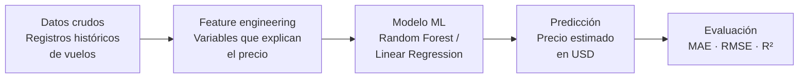
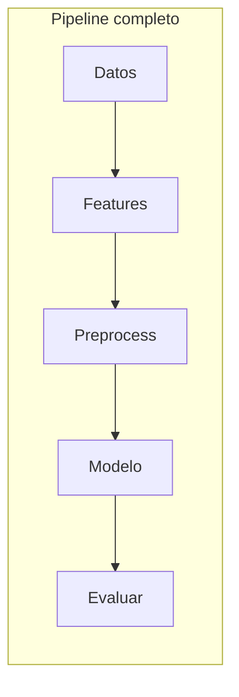
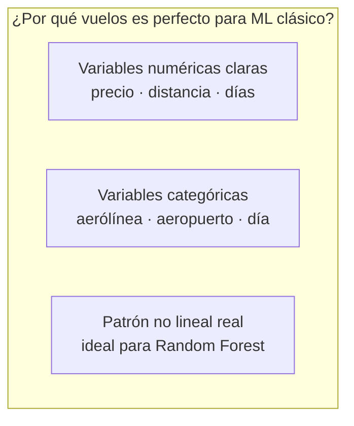

# 205.01 - Flight Price Predictor

> **Step 1 of 3 · Classical ML** — Predict flight prices using scikit-learn and synthetic data.

---

## Cómo funciona el ML clásico (supervisado)







---

## Conceptos clave antes de tocar el código

### Concepto 1 — ¿Qué es el Machine Learning supervisado?

La idea central es simple: **en lugar de programar reglas, le mostrás ejemplos al modelo y él aprende las reglas solo.**

Con programación tradicional harías algo así:

```
si destino == "Madrid" y anticipación < 7 días → precio alto
si aerolínea == "low cost" → descuento 20%
...
```

El problema es que hay miles de combinaciones y nunca terminás de escribir todas las reglas.

Con ML supervisado le das 5.000 vuelos con sus precios reales, y el modelo descubre solo que "los vuelos a Madrid comprados con menos de una semana en aerolínea premium un viernes" cuestan mucho más. Vos no escribiste esa regla — él la infirió.

**Supervisado** significa que cada ejemplo tiene una respuesta correcta. Le mostrás el vuelo *y* el precio. Si le mostraras solo los vuelos sin precios, sería no supervisado.

---

### Concepto 2 — Features y Target

El **target** es lo que querés predecir. En nuestro caso: el precio en dólares.

Las **features** son todas las variables que el modelo recibe como input: destino, aerolínea, días de anticipación, hora de salida, etc.

La regla de oro que no podés violar jamás: **el target nunca puede estar entre las features**. Si le das el precio como input para predecir el precio, el modelo simplemente lo copia — aprende nada y en producción falla.

Hay un error más sutil llamado **data leakage**: incluir features que en la realidad no tendrías disponibles al momento de predecir. Por ejemplo, "número de pasajeros en ese vuelo" — esa info no existe cuando el cliente está comprando el ticket.

```
X (features)          y (target)
──────────────────    ──────────
destino               precio_usd  ← esto es lo que queremos predecir
aerolínea
días_anticipación
día_semana
hora_salida
num_escalas
```

---

### Concepto 3 — Train / Test Split

Imaginá que le das a un alumno exactamente el mismo examen que usaste para enseñarle. Saca 100. ¿Aprendió o memorizó?

Lo mismo pasa con los modelos. Si entrenás con todos los datos y medís el error sobre esos mismos datos, el resultado parece perfecto pero el modelo no aprendió nada generalizable — solo memorizó. Esto se llama **overfitting**.

La solución es separar los datos *antes de entrenar*:

```
Dataset completo (5.000 vuelos)
│
├── 80% Train (4.000 vuelos) → el modelo aprende acá
└── 20% Test  (1.000 vuelos) → el modelo nunca los ve durante el entrenamiento
                               → acá medimos si realmente aprendió
```

Si el error en test es bueno, el modelo genuinamente aprendió. Si el error en train es bajo pero en test es alto, el modelo memorizó — hay overfitting.

---

### Concepto 4 — Overfitting y Underfitting

Estos dos son los enemigos opuestos del ML.

**Underfitting** — el modelo es demasiado simple para capturar los patrones. Como intentar predecir precios con solo una regla: "vuelos más largos = más caros". Ignora el día, la aerolínea, la anticipación. Error alto tanto en train como en test.

**Overfitting** — el modelo aprendió los datos de entrenamiento demasiado bien, incluyendo el ruido y las coincidencias aleatorias. Error muy bajo en train, error alto en test. Es el modelo que "estudió solo esas preguntas" y no puede resolver preguntas nuevas.

```
Underfitting          Punto ideal          Overfitting
─────────────         ────────────         ───────────
Modelo muy simple     Generaliza bien      Modelo muy complejo
Error train: ALTO     Error train: bajo    Error train: MUY BAJO
Error test:  ALTO     Error test:  bajo    Error test:  ALTO
```

El objetivo es el punto intermedio: un modelo que generaliza.

---

### Concepto 5 — Preprocesamiento

Los algoritmos de ML son matemática pura — operan sobre números. "Aerolínea A" no es un número. Hay dos problemas a resolver:

**Variables categóricas (texto) → One-Hot Encoding**

"Aerolínea A" se convierte en una columna nueva con 0 o 1. Si hay 4 aerolíneas, aparecen 4 columnas nuevas, y exactamente una es 1 por fila.

```
Aerolínea A → [1, 0, 0, 0]
Aerolínea B → [0, 1, 0, 0]
Aerolínea C → [0, 0, 1, 0]
Aerolínea D → [0, 0, 0, 1]
```

¿Por qué no asignar simplemente 1, 2, 3, 4? Porque el modelo interpretaría que Aerolínea D (=4) es "el doble" de Aerolínea B (=2), lo cual no tiene ningún sentido.

**Variables numéricas con escalas distintas → StandardScaler**

`distance_km` va de 1.000 a 10.000. `num_stops` va de 0 a 2. Sin normalizar, la distancia domina matemáticamente solo por ser un número más grande. StandardScaler transforma cada columna para que tenga media 0 y desviación estándar 1 — todas las variables quedan en la misma escala.

---

### Concepto 6 — Los dos modelos y por qué son distintos

**Regresión Lineal** busca una fórmula del tipo:

```
precio = 0.03 × distancia + (-15) × días_anticipación + ...
```

Cada feature tiene un peso fijo. Asume que la relación entre cada variable y el precio es una línea recta. Muy interpretable pero demasiado simple — no puede capturar "los viernes son caros *pero solo en combinación con poca anticipación*".

**Random Forest** construye 100 árboles de decisión distintos. Cada árbol hace preguntas encadenadas:

```
¿distancia > 5000?
  └── sí → ¿día == viernes?
              └── sí → ¿anticipación < 7?
                          └── sí → precio estimado: $800
```

Cada árbol ve una muestra aleatoria de los datos. Al final, el precio predicho es el promedio de los 100 árboles. Esto captura interacciones complejas entre variables sin que vos las definas manualmente.

---

### Concepto 7 — Métricas de evaluación

Una vez que el modelo predice sobre el test set, necesitás medir qué tan equivocado está.

| Métrica | Fórmula simplificada | Interpretación |
|---------|----------------------|----------------|
| **MAE** | promedio de \|real − predicho\| | Error promedio en dólares. Fácil de explicar. |
| **RMSE** | raíz del promedio de (real − predicho)² | Penaliza más los errores grandes. Siempre ≥ MAE. |
| **R²** | % de varianza explicada por el modelo | 1.0 = perfecto · 0.0 = predecir siempre el promedio |

En nuestro caso los resultados fueron:

```
                    LinearRegression    RandomForest
MAE ($ error prom)      $66.84            $33.53  ✅
RMSE                    $89.15            $50.70  ✅
R²                       0.889             0.964  ✅
```

Random Forest ganó claramente porque los precios de vuelos tienen patrones no lineales que la regresión lineal no puede capturar.

---

## Project structure

```
205.01-flight-price-predictor/
├── data/
│   └── flights_synthetic.csv   # Generated by generate_data.py
├── models/
│   └── flight_model.pkl        # Saved model (after training)
├── notebooks/
│   └── 01_exploration.ipynb    # EDA + concept explanations
├── app/
│   └── streamlit_app.py        # Interactive predictor UI
├── generate_data.py            # Synthetic dataset generator
├── train_model.py              # Full training pipeline
└── requirements.txt
```

## How to run

```bash
# 1. Install dependencies
pip install -r requirements.txt

# 2. Generate synthetic flight data
python generate_data.py

# 3. Train and evaluate the model
python train_model.py

# 4. Launch the Streamlit app
streamlit run app/streamlit_app.py
```

---

## Next step

→ [205.02 - Document Chatbot](../205.02-document-chatbot) · LLMs + RAG with Hugging Face + ChromaDB
